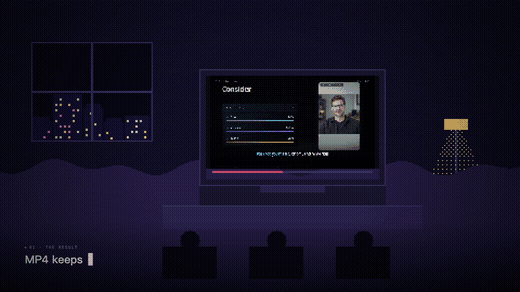
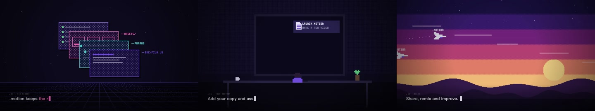

# Pixel Platformer · Product Introduction

Explain a digital product with a pixel city, platform-game actions and retro game sound.

**16:9 · 1920 × 1080 · 60 fps · v2.5.3** · [@motiongit](https://motiongit.com/@motiongit) · [简体中文](README.zh-CN.md)

**[Template details, full .motion & demo](https://motiongit.com/@motiongit/motiongit-promo-pixel)**
https://motiongit.com/@motiongit/motiongit-promo-pixel

Download available; current terms are listed with the package.

## Demo

[Full demo](https://motiongit.com/@motiongit/motiongit-promo-pixel) · [Play video](https://media.openaicut.com/previews/586/draft-en-45375e2037e0.mp4)

## How it works

- Declared runtime profile: html-canvas/1.
- Editable inputs are mapped through the template parameter schema and preset to its existing animation project.
- The declared duration policy follows the current content; the package plan determines final timing.

Demo duration: **66s**. The documented output is 1920 × 1080, 60 fps. The public demo is 66 seconds. Use the actual package parameter bounds; extra materials do not automatically create extra scenes. Portrait output or live presenter/video footage: this template accepts static images only Shortening source actions, automatically matching cuts to voice words, or changing the original pixel style

## Inputs and materials

- **Required:** Your topic, script and facts to preserve.
- **Optional:** Current product images, screenshots or display materials supported by the selected media slots.
- **Optional:** The current brand name, logo and applicable feature icons.
- **Optional:** A licensed music track or your preference for music in this production.
- **Optional:** The current voice recording or your narration preference for this production.

Useful for: Current product introductions, feature explanations and brand stories · Select complete source scenes for comparison, process, collections, connections or a conclusion

## Runtime requirements

- The package declares a Python and Node.js host. Check its dependency lock for supported versions and any additional rendering tools.
- Use the package dependency lock and setup/check instructions. Check existing tools first, install only missing requirements and verify a preview.

## Use the template

1. Obtain the current .motion package from the [template page](https://motiongit.com/@motiongit/motiongit-promo-pixel).
2. Extract or load it as documented, then read the included README and referenced production guide.
3. Use your own content and materials, reuse the working environment, and follow the package entry point to inspect a real preview.

You can give an assistant the repository URL and this request:

> https://github.com/motiontemplates/252912
>
> Use this .motion template with my content. Obtain the package from https://motiongit.com/@motiongit/motiongit-promo-pixel, extract or load it as documented, read the included README and referenced guide, reuse my working environment, and follow the package workflow to show an actual preview.

## .motion format

MotionGit .motion is a reusable video-template format that organizes the animation project, parameters, assets, dependencies and production guide. Its runtime uses new content to produce a finished video. [Format documentation](https://motiongit.com/spec)

[Versions, license & full download](https://motiongit.com/@motiongit/motiongit-promo-pixel) · [Production reference](ASSISTANT.md)
